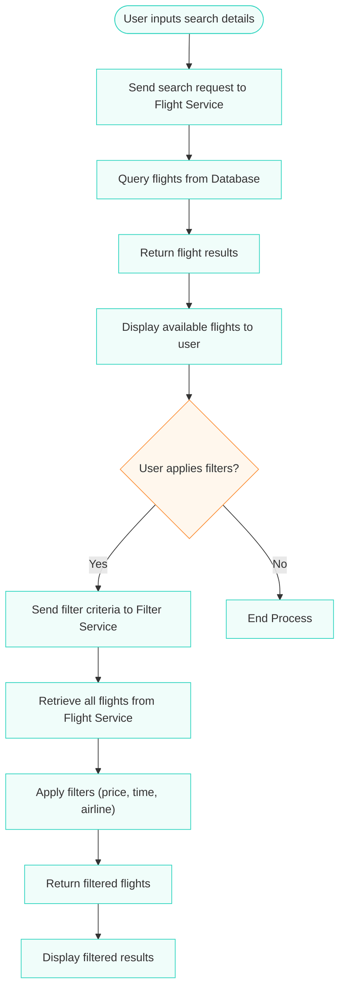
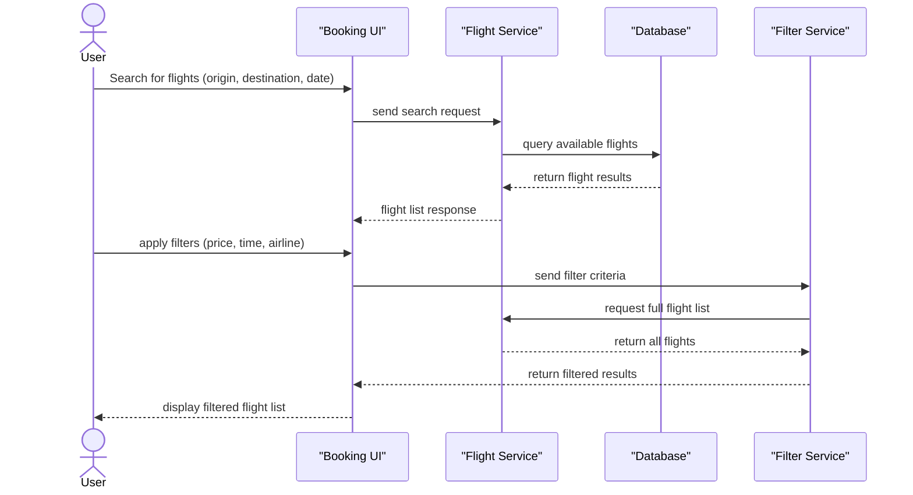

# Booking-system ✈
A system for booking flights and hotels in easy way 

## Vision ✨
A system that enables users to book the most sutable flights and hotels all over the world in easy way. 

## User Roles 
- Clients 
- Site admins 
- Companies admins 

## Project modules 
1. Authentication
2. User
3. Search 
4. Flights companies
5. Hotels companies
6. Tickts
7. Payment integration
8. Status tracking
9. Notification systems e.g email and sms

## Features and Functions 
### 1. Authentication
   - Register
   - Login
   - logout
   - Forget password
   - Verfiy mail

### 2. User
   - Get profile
   - Update profile
   - Delete account
   - Search and book the sutable flight or hotel

### 3. Search 
   - Get all available trips by user requirements
   - Get all available rooms by user requirements 

### 4. Flights companies
   - Add trips
   - Get the number of booked seats
   - Get the travelers details
   - Get reviews 

### 5. Hotels companies
   - Add available rooms
   - Update available rooms
   - Get the booked rooms
   - Add offers
   - Get the booked user details
   - Get reviews

### 6. Tickets
   - Create a ticket
   - Update a ticket

### 7. Notification system
   - Notify via sms
   - Notify via email

## Search and filter flight flowchart 


## Search and filter flight sequence diagram 

## Search and filter Pseduo code 

```
FUNCTION searchFlights(origin, destination, date):
    query = buildQuery(origin, destination, date)
    results = DB.queryFlights(query)
    RETURN results

FUNCTION filterFlights(criteria, flights):
    filtered = []
    FOR flight IN flights:
        IF matchesCriteria(flight, criteria):
            filtered.append(flight)
    RETURN filtered

MAIN:
    userInput = getSearchInput()
    flightResults = searchFlights(userInput.origin, userInput.destination, userInput.date)
    display(flightResults)

    IF userWantsToFilter():
        filterCriteria = getFilterInput()
        filteredResults = filterFlights(filterCriteria, flightResults)
        display(filteredResults)
```
